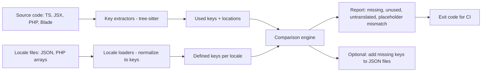
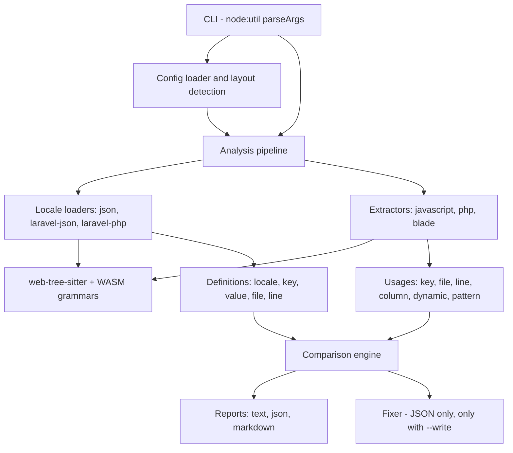
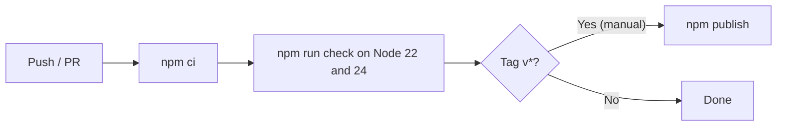

# i18n-drift

**Find missing, unused, and untranslated translation keys across Laravel and JavaScript code in one check, before your users see raw keys.**

i18n-drift is a command-line tool that compares the translation keys your code actually uses with the keys defined in your locale files. It reports keys that are missing in a locale, keys that no code references anymore, values that were never translated, empty values, and placeholder mismatches between languages. It is built for real-world mixed codebases, such as a Laravel backend with Blade views and a React or Vue frontend (Inertia apps), where translations live in both PHP language files and JSON.

> **Project status: v0.1.0.** The core described in this document is implemented and tested: Laravel and JSON loaders, JavaScript/TypeScript, PHP and Blade extractors, eight checks, text/JSON/Markdown reports, and `fix --write` for JSON locale files. Features marked 📋 are planned and not implemented. The package has not been published to npm yet; install it from a clone (see [Installation](#installation)).

---

## Table of Contents

- [Overview](#overview)
- [Problem Statement](#problem-statement)
- [Proposed Solution](#proposed-solution)
- [Goals](#goals)
- [Target Audience](#target-audience)
- [Feature Status](#feature-status)
- [Detailed Feature Breakdown](#detailed-feature-breakdown)
- [Architecture](#architecture)
- [Technology Stack](#technology-stack)
- [Project Directory Structure](#project-directory-structure)
- [Installation](#installation)
- [Quick Start](#quick-start)
- [Configuration](#configuration)
- [CLI Reference](#cli-reference)
- [Usage Examples](#usage-examples)
- [JSON Report Schema](#json-report-schema)
- [CI Integration](#ci-integration)
- [Development Workflow](#development-workflow)
- [Testing Strategy](#testing-strategy)
- [Security Considerations](#security-considerations)
- [Performance](#performance)
- [Limitations](#limitations)
- [Release Workflow](#release-workflow)
- [Roadmap](#roadmap)
- [Prior Art](#prior-art)
- [Contributing](#contributing)
- [License](#license)
- [Author, Ownership & Attribution](#author-ownership--attribution)

---

## Overview

| Item | Detail |
|---|---|
| Type | Command-line tool (Node.js 22+) |
| Locale formats | JSON (flat and nested, single-file or one file per namespace), Laravel PHP array files, Laravel JSON translations |
| Code scanned | JavaScript/TypeScript/JSX/TSX (`t()`, `$t()`, `i18n.t()`, `<Trans>`, `useTranslation`), PHP (`__()`, `trans()`, `trans_choice()`, `Lang::get()`, `Lang::choice()`), Blade (`{{ __() }}`, `{!! !!}`, `@lang`, `@choice`, `@php`, bound component attributes) |
| Dependencies at runtime | `web-tree-sitter` (with vendored WASM grammars) and `fast-glob` |
| Exit codes | `0` ok, `1` findings at or above `--fail-on`, `2` usage/configuration error |

## Problem Statement

Translation bugs are easy to ship and embarrassing to find:

- A developer adds `t('checkout.discount_applied')` but forgets to add it to the Hindi or French locale, so users see the raw key.
- Features are removed, but their keys stay in every locale file, so translators keep translating text nobody sees.
- A value is copied from English into another locale "to translate later" and never is.
- Placeholders drift: English says `Hello, :name` while Spanish says `Hola, :nombre`, so the variable is never filled.

Existing tools usually cover **one ecosystem**: i18next-focused extractors for JavaScript, or Laravel-specific packages for PHP. Teams with a Laravel backend and a JavaScript frontend end up with two partial checks, or none.

## Proposed Solution



## Goals

- One tool that understands both Laravel and JavaScript translation conventions.
- Accurate extraction using syntax trees, so keys in comments or unrelated strings are not counted.
- Honest handling of dynamic keys (``t(`status.${s}`)``): report them and allow explicit patterns, rather than guessing.
- Fast enough for a pre-commit hook on medium projects (see [Performance](#performance) for a measurement).
- Never modify locale files unless explicitly asked (`fix --write`).

## Target Audience

- Laravel developers, especially with Inertia (React or Vue) frontends.
- React, Next.js, and Vue teams using i18next or react-i18next (script code; see [Limitations](#limitations) for what is not covered yet).
- Product teams shipping in multiple languages, including Indian-language localization (Hindi, Gujarati, and others). The bundled fixtures use Hindi and Gujarati text to exercise Unicode handling.

## Feature Status

Legend: ✅ Implemented · 📋 Planned

| Feature | Status |
|---|---|
| Locale loaders: JSON (nested and flat, namespaced or single-file) | ✅ |
| Locale loaders: Laravel PHP arrays (parsed with tree-sitter, never executed) | ✅ |
| Locale loaders: Laravel JSON | ✅ |
| Locale loaders: YAML | 📋 (v0.2) |
| Key extraction: JS/TS/JSX/TSX (calls, `<Trans>`, `useTranslation`, `ns` option) | ✅ |
| Key extraction: PHP and Blade | ✅ |
| Key extraction: Vue single-file components | 📋 (v0.2) |
| Key extraction: next-intl namespaces | 📋 (v0.2) |
| Checks: `missing`, `unused`, `untranslated`, `empty`, `extra` | ✅ |
| Checks: `placeholder-mismatch` (Laravel, ICU, i18next syntaxes) | ✅ |
| Dynamic key reporting, derived patterns and `dynamicKeyPatterns` | ✅ |
| Checks: `unknown-value` (PHP values that are not literals) | ✅ |
| Text, JSON and Markdown reports | ✅ |
| `fix` / `fix --write` for JSON locale files | ✅ |
| `fix` for PHP locale files | Lists the keys to add manually (files are never modified) |
| `init` and layout auto-detection | ✅ |
| CI workflow for this repository (Node 22 and 24) | ✅ |
| Content-hash cache | 📋 (v0.3) |
| Published GitHub Action | 📋 (v0.3) |
| Docker image | 📋 (v0.3) |

## Detailed Feature Breakdown

### 1. Locale loading

Every locale file is normalized to keys per locale, with the file and line of each definition:

| Format | Example path | Normalized key |
|---|---|---|
| Laravel PHP array | `lang/en/auth.php` → `['failed' => '...']` | `auth.failed` |
| Laravel PHP array in a directory | `lang/en/admin/users.php` → `['title' => '...']` | `admin/users.title` |
| Laravel JSON | `lang/hi.json` → `{"Welcome back": "..."}` | `Welcome back` (used verbatim) |
| i18next JSON, one file per namespace | `public/locales/en/common.json` → `{"nav": {"home": "..."}}` | `common:nav.home` (separator configurable) |
| JSON, one file per locale | `locales/en.json` → `{"nav": {"home": "..."}}` | `nav.home` |

Laravel PHP language files are parsed with the PHP grammar (tree-sitter), never executed. i18n-drift does not need PHP installed and never runs project code. Only the literal contents of the top-level `return [ ... ];` array are read: nested arrays, single- and double-quoted strings, integer keys and concatenation of literals work. Function calls, constants, variables, interpolated strings and heredocs are recorded as keys with an unknown value and reported as `unknown-value` notes. A language file with a syntax error, or without a top-level returned array, is an error (exit code 2), the same as invalid JSON.

### 2. Key extraction from code

| Ecosystem | Recognized |
|---|---|
| JavaScript / TypeScript / JSX / TSX | Calls to the configured `functions` (default `t`, `$t`, `i18n.t`, `i18next.t`) whose first argument is a string or a template literal without substitutions; `<Trans i18nKey="...">` (string, expression or template attribute, plus an `ns` attribute); `useTranslation('ns')` sets the default namespace for `t` calls in the same function (including nested callbacks), aliases from `const { t: translate } = useTranslation()` are followed; `t('key', { ns: 'other' })`; conditional keys (`t(a ? 'x' : 'y')`) count both branches |
| PHP | `__('key')`, `trans('key')`, `trans_choice('key', n)`, `Lang::get('key')`, `Lang::choice('key', n)`, also with a leading backslash or a fully qualified `Lang` facade name, and `key:` named arguments |
| Blade | `{{ __('key') }}`, `{!! __('key') !!}`, `{{{ }}}`, `@lang('key')`, `@choice('key', n)`, translation calls inside any directive expression (`@if(__('x'))`, `@include('v', ['t' => __('x')])`), `@php ... @endphp`, `@php(...)`, `<?php ... ?>`, `<?= ... ?>`, and bound component attributes (`<x-button :label="__('Save')" />`) |

Positions are exact: Blade fragments are parsed separately and mapped back to line and column in the template, including after Unicode text. Comments, strings that merely contain a call, lookalike functions (`format('x')`, `tt('x')`), object keys, imports, method calls such as `$this->trans('x')`, `Blade {{-- comments --}}`, `@verbatim` blocks and escaped output (`@{{ }}`, `@@lang`) are never counted; the unit tests prove each of these.

### 3. Checks

| Check | ID | Default severity | Rule |
|---|---|---|---|
| Used but missing | `missing` | error | A static usage key is not defined in a locale (reported per locale). Also reported when the base locale defines a key that is used through a dynamic pattern and another locale lacks it |
| Unused | `unused` | warning | A key defined in the base locale is not used by any static usage, derived dynamic pattern or `dynamicKeyPatterns` entry |
| Untranslated | `untranslated` | warning | A non-base value is identical to the base value, unless the key or value is allowlisted, the value is shorter than 3 characters, or it has no letters left after removing placeholders |
| Empty | `empty` | error | A non-base value is an empty string |
| Extra | `extra` | warning | A key defined in a non-base locale but not in the base locale |
| Placeholder mismatch | `placeholder-mismatch` | error | The set of placeholders in a non-base value differs from the base value |
| Dynamic key | `dynamic-key` | note | A usage whose key cannot be resolved statically (with its pattern if known) |
| Unknown value | `unknown-value` | note | A definition whose value is not statically known, or a PHP array entry that had to be skipped |

The base locale (default `en`; if there is no `en`, the first locale found) is the reference for the untranslated, placeholder and extra checks. Every severity can be changed or switched off with `"off"` in the [configuration](#configuration). Output is deterministic: findings are sorted by severity, locale, file, line, key and check id.

**Key resolution order.** A usage key is looked up verbatim in each locale. If it has no namespace separator it is also tried in `defaultNamespace` (default `translation`). For JSON definitions the i18next plural suffixes `_zero`, `_one`, `_two`, `_few`, `_many`, `_other` and `_plural` are accepted, so `t('items')` is satisfied by `items_one` and `items_other`, and a locale with extra plural forms (for example French `items_many`) is not reported as `extra`. For Laravel, a dotted key such as `auth.failed` is matched against the PHP array definitions and, failing that, the JSON definitions; a key such as `Welcome back` is matched against the JSON definitions. If the same key exists in both, the PHP definition wins.

### 4. Placeholders

| Syntax | Examples | Notes |
|---|---|---|
| Laravel | `:name` | `:name`, `:Name` and `:NAME` are the same placeholder, matching Laravel's casing behavior. Times (`10:30`), URLs and `Note:text` are not placeholders |
| ICU | `{name}`, `{count, plural, one {# item} other {# items}}`, `{gender, select, ...}` | Argument names inside plural/select branches are found; quoting with `'` is honored |
| i18next | `{{name}}`, `{{ name }}`, `{{- html}}`, `{{date, datetime}}` | The name before the comma is used |

Defaults: Laravel files use the Laravel syntax; JSON files use i18next. ICU is opt-in through `placeholderSyntax`.

### 5. Dynamic keys

Calls such as ``t(`order.status.${status}`)``, `t('a.' + kind)` or ``__("roles.$role")`` cannot be resolved statically. i18n-drift reports them as `dynamic-key` notes with their location and, when static text surrounds the dynamic part, derives a pattern with `*` as the wildcard (`order.status.*`, `a.*.label`). Defined keys matching a derived pattern are treated as used, so they do not appear as `unused`, and the other locales must define them. For dynamic keys that the tool cannot see at all (for example keys passed in from the server), declare `dynamicKeyPatterns` in the configuration. In patterns, `*` matches one or more characters, including dots.

### 6. Adding missing keys

`i18n-drift fix` prints the keys it would add. `i18n-drift fix --write` adds each missing key of a non-base locale to its **JSON** locale file, with the base value prefixed by a marker (default `[TODO] `, change it with `--marker`) so the entries are easy to find. The file is edited textually: indentation (2 spaces, 4 spaces or tabs), key order (new keys are appended inside their parent object), line endings and the trailing newline are preserved, and running the command again adds nothing. Files are replaced atomically (temporary file plus rename), symbolic links are refused, paths are confined to the project, and every edit is computed before any file is written, so an invalid file leaves all files untouched. PHP language files are never modified; the keys to add are listed instead. Keys that the base locale does not define cannot be fixed (there is no value to copy) and are listed as well.

## Architecture



There is no server, database, or authentication; i18n-drift runs entirely locally. See [docs/ARCHITECTURE.md](docs/ARCHITECTURE.md) for the components and design decisions.

## Technology Stack

| Concern | Choice | Reason |
|---|---|---|
| Language | TypeScript (strict, ESM) on Node.js 22+ | Matches the JavaScript ecosystem; easy npm distribution |
| Parsing | `web-tree-sitter` 0.25 with JavaScript, TypeScript, TSX and PHP grammars (WASM, vendored in `grammars/`) | Accurate syntax trees, no native builds |
| Blade | Custom scanner for echoes, directives, PHP blocks and component attributes; PHP fragments are parsed with the PHP grammar | Blade has no official tree-sitter grammar |
| JSON | Small position-aware parser (`src/locales/json-ast.ts`) | Needs line numbers for every key and exact offsets for the fixer |
| Globbing | `fast-glob` | Fast, symlink-safe file listing |
| CLI | `node:util` `parseArgs` | No dependency needed |
| Configuration validation | Hand-written validators | The configuration is small; every message names the JSON path (`$.severity.missing`) without adding a schema library |
| Build | `tsup` | Single bundled `dist/cli.js` with a shebang |
| Testing | Vitest with V8 coverage | Fast TypeScript tests |

## Project Directory Structure

```text
i18n-drift/
├── src/
│   ├── cli.ts              # process entry point (exit codes for signals and closed pipes)
│   ├── app.ts              # argument parsing, commands, output
│   ├── analyze.ts          # locale loading + source scanning + checks
│   ├── config.ts           # configuration validation and loading
│   ├── detect.ts           # Laravel and i18next layout detection
│   ├── compare.ts          # the checks
│   ├── placeholders.ts     # Laravel, ICU and i18next placeholder extraction
│   ├── fix.ts              # planning and applying JSON additions
│   ├── parser.ts           # web-tree-sitter initialization and grammar loading
│   ├── locales/            # json.ts, json-ast.ts, laravel-json.ts, laravel-php.ts, pattern.ts, flatten.ts, index.ts
│   ├── extractors/         # javascript.ts, php.ts, blade.ts, index.ts
│   └── report/             # text.ts, json.ts, markdown.ts, summary.ts, index.ts
├── grammars/               # WASM grammars + provenance notice and license
├── test/
│   ├── unit/               # loaders, extractors, placeholders, checks, config, detection, fixer
│   ├── integration/        # fixture projects, in-process CLI, spawned dist/cli.js
│   └── fixtures/           # laravel-inertia-react, react-i18next, blade-only, clean, safety
├── docs/                   # ARCHITECTURE.md, DEVELOPMENT.md, ROADMAP.md
├── SPEC.md                 # behavior specification and decisions
└── package.json
```

## Installation

i18n-drift is not published to npm yet (the name `i18n-drift` was free when checked on 2026-10-31). Install it from a clone; Node.js 22 or newer is required:

```bash
git clone https://github.com/yagnang-vyas/i18n-drift.git
cd i18n-drift
npm ci
npm run build
npm link            # puts the i18n-drift command on your PATH
i18n-drift --version
```

Without `npm link`, run `node dist/cli.js` from the clone. After the first npm release, `npx i18n-drift check` and `npm install --save-dev i18n-drift` will work.

## Quick Start

From the root of a Laravel project or a JavaScript project with i18next-style locale folders:

```bash
i18n-drift init        # optional: write i18n-drift.config.json from the detected layout
i18n-drift check       # report drift; exits 1 when there are errors
i18n-drift fix         # preview the keys that fix --write would add to JSON files
```

Without a config file, the layout is auto-detected (add `--verbose` to see what was detected):

- **Laravel**: an `artisan` file plus `lang/` or `resources/lang/`. Locale files: `lang/{locale}/{namespace}.php` and `lang/{locale}.json`. Sources: `app/**/*.php`, `routes/**/*.php`, `resources/**/*.{php,js,jsx,ts,tsx,mjs,cjs}`.
- **i18next layouts**: `public/locales`, `src/locales`, `locales` and `resources/js/locales`, either `{locale}/{namespace}.json` or `{locale}.json`. Sources: `**/*.{js,jsx,ts,tsx,mjs,cjs}`.

By default `node_modules`, `vendor`, `dist`, `build`, `.next`, `.nuxt`, `coverage`, `storage`, `*.d.ts`, `*.min.js`, test files (`*.test.*`, `*.spec.*`, `__tests__`) are excluded. Locale files are never scanned as source files.

## Configuration

`i18n-drift.config.json` is optional. Patterns are relative to the directory containing the file. Unknown keys and invalid values are errors (exit code 2) that name the JSON path, for example `$.severity.missing: expected "error", "warning", "note" or "off"`. Keys that are left out use the defaults below; if `localeFiles`, `sources` or `exclude` are left out, the auto-detected values are used.

```json
{
  "baseLocale": "en",
  "locales": ["en", "hi", "gu"],
  "sources": ["app/**/*.php", "resources/**/*.{php,ts,tsx}"],
  "exclude": ["resources/js/legacy/**"],
  "localeFiles": [
    { "format": "laravel-php", "path": "lang/{locale}/{namespace}.php" },
    { "format": "laravel-json", "path": "lang/{locale}.json" }
  ],
  "functions": ["t", "$t", "translate"],
  "dynamicKeyPatterns": ["notifications.*"],
  "untranslatedAllowlist": ["Lumen Ledger", "messages.brand_*"],
  "severity": { "unused": "warning", "untranslated": "off" },
  "placeholderSyntax": { "json": ["i18next", "icu"] }
}
```

| Key | Type | Default | Description |
|---|---|---|---|
| `baseLocale` | string | `en`, else the first locale found | Reference locale for untranslated, placeholder and extra checks |
| `locales` | string[] | every locale found | Locales to check (the base locale is always included) |
| `sources` | string[] | detected | Globs of source files to scan (`.js .jsx .mjs .cjs .ts .tsx .mts .cts .php`, Blade files end in `.blade.php`) |
| `exclude` | string[] | detected | Globs to skip; `**/node_modules/**`, `**/vendor/**` and `**/.git/**` are always skipped |
| `localeFiles` | `{format, path}[]` | detected | `format` is `json`, `laravel-php` or `laravel-json`. `path` must contain `{locale}`; `{namespace}` captures the file name (and subdirectories) below it and is required for `laravel-php`. For `json` the namespace becomes the key prefix (`common:save`) |
| `functions` | string[] | `["t", "$t", "i18n.t", "i18next.t"]` | JavaScript/TypeScript function names treated as translation calls; member calls are matched by their text (`this.$t`). PHP functions are fixed |
| `namespaceSeparator` | string | `:` | Separator between an i18next namespace and a key |
| `defaultNamespace` | string | `translation` | Namespace tried for keys without one; `""` disables the fallback |
| `dynamicKeyPatterns` | string[] | `[]` | Key globs whose definitions count as used; `*` matches one or more characters including dots |
| `untranslatedAllowlist` | string[] | `[]` | Entries that are never reported as untranslated. Each entry is matched against the key (with `*`) and against the exact value |
| `severity` | object | see [Checks](#3-checks) | Maps a check id to `error`, `warning`, `note` or `off` |
| `placeholderSyntax` | object | `json: ["i18next"]`, `laravel-php` and `laravel-json`: `["laravel"]` | Maps a locale file format to one syntax or an array of `laravel`, `icu`, `i18next` |

The only environment variable i18n-drift reads is `NO_COLOR`.

## CLI Reference

```text
i18n-drift 0.1.0
Find missing, unused and untranslated translation keys across Laravel and JavaScript code.

Usage:
  i18n-drift check [options]   Compare used keys with locale files and report drift
  i18n-drift keys  [options]   List the translation keys found in source code
  i18n-drift fix   [options]   Add missing keys to JSON locale files (dry run unless --write)
  i18n-drift init  [options]   Write i18n-drift.config.json from the detected project layout

Options:
  -c, --config FILE      Config file (default: ./i18n-drift.config.json, else auto-detect)
      --locale CODE      Only report/fix this locale (repeatable)           [check, fix]
      --only IDS         Comma-separated check ids to report                [check]
      --format FORMAT    check: text|json|markdown, keys: text|json         [check, keys]
      --fail-on LEVEL    error|warning|note|never (default: error)          [check]
      --write            Apply the fixes instead of printing them           [fix]
      --marker TEXT      Value prefix for added keys (default "[TODO] ")    [fix]
      --force            Overwrite an existing config file                  [init]
      --verbose          Print the detected layout and counts to stderr
  -v, --version          Print the version
  -h, --help             Print this help

Check ids: missing, unused, untranslated, empty, extra, placeholder-mismatch, dynamic-key, unknown-value
Exit codes: 0 ok, 1 findings at or above --fail-on, 2 usage or configuration error.
```

| Command | Description |
|---|---|
| `i18n-drift check` | Run all checks and print a report |
| `i18n-drift keys` | List the keys found in source code with `file:line:column`; dynamic keys show their pattern |
| `i18n-drift fix [--write]` | Show, or with `--write` apply, the keys to add to JSON locale files |
| `i18n-drift init [--force]` | Detect the project layout and write `i18n-drift.config.json` |

| Option | Commands | Description |
|---|---|---|
| `-c, --config FILE` | check, keys, fix | Config file; the project root is its directory |
| `--locale CODE` | check, fix | Limit to a locale; repeat or comma-separate. Unknown locales are an error. `check` still shows findings without a locale (dynamic keys) |
| `--only IDS` | check | Comma-separated check ids, e.g. `missing,placeholder-mismatch` |
| `--format FORMAT` | check, keys | `check`: `text` (default), `json`, `markdown`. `keys`: `text`, `json` |
| `--fail-on LEVEL` | check | Lowest severity that yields exit code 1: `error` (default), `warning`, `note`, or `never` |
| `--write` | fix | Apply the changes. Without it nothing is ever written |
| `--marker TEXT` | fix | Prefix for added values (default `[TODO] `) |
| `--force` | init | Overwrite an existing config file |
| `--verbose` | check, keys, fix | Print the config source, detected layout and counts to stderr |

**Exit codes**

| Code | Meaning |
|---|---|
| `0` | Nothing at or above `--fail-on` (default `error`) |
| `1` | Findings at or above `--fail-on` |
| `2` | Usage or configuration error, invalid locale file, unexpected failure. The message is one line: `i18n-drift: error: <message>` with no stack trace |
| `130` | Interrupted (SIGINT) |
| `141` | The output pipe was closed early (for example `i18n-drift check \| head`); exits quietly |

Text output has no colours unless stdout is a terminal and `NO_COLOR` is unset.

## Usage Examples

All output below was produced by running the built CLI on the fixture projects in `test/fixtures/`. The fixtures are small invented projects (an invoicing app called "Lumen Ledger") with deliberately seeded problems, so the findings are expected.

### `check` on a Laravel + Inertia (React) project

```bash
cd test/fixtures/laravel-inertia-react
i18n-drift check
```

```text
error    missing               en  Create invoice               resources/views/welcome.blade.php:24        used once but not defined in "en"
error    missing               gu  admin/users.invite           app/Http/Controllers/AuthController.php:15  used once but not defined in "gu"
error    missing               gu  status.void                  lang/en/status.php:6                        used through a dynamic key pattern ("en" defines it) but not defined in "gu"
error    empty                 gu  messages.footer_note         lang/gu/messages.php:9                      translation is an empty string
error    missing               gu  Dismiss                      resources/js/Pages/Auth/Login.tsx:13        used once but not defined in "gu"
error    missing               gu  billing.invoice_overdue      resources/js/Pages/Billing/Index.tsx:16     used once but not defined in "gu"
error    missing               gu  admin/users.title            resources/js/Pages/Dashboard.tsx:18         used once but not defined in "gu"
error    missing               gu  Create invoice               resources/views/welcome.blade.php:24        used once but not defined in "gu"
error    missing               hi  auth.throttle                app/Http/Controllers/AuthController.php:13  used once but not defined in "hi"
error    placeholder-mismatch  hi  messages.welcome_title       lang/hi/messages.php:7                      placeholders differ: "en" has :name, "hi" has :naam
error    missing               hi  Create invoice               resources/views/welcome.blade.php:24        used once but not defined in "hi"
warning  unused                en  Archive client               lang/en.json:7                              defined but not used by any static key or dynamic key pattern
warning  unused                en  admin/users.deprecated_note  lang/en/admin/users.php:6                   defined but not used by any static key or dynamic key pattern
warning  unused                en  messages.legacy_banner       lang/en/messages.php:13                     defined but not used by any static key or dynamic key pattern
warning  untranslated          gu  messages.export_csv          lang/gu/messages.php:15                     value is identical to the "en" value
warning  extra                 hi  messages.old_promo           lang/hi/messages.php:16                     defined in "hi" but not in base locale "en"
note     dynamic-key           -   roles.*                      app/Http/Controllers/AuthController.php:17  key is computed at runtime; assuming it matches "roles.*"
note     dynamic-key           -   status.*                     resources/js/Pages/Billing/Index.tsx:5      key is computed at runtime; assuming it matches "status.*"
note     dynamic-key           -   -                            resources/js/Pages/Billing/Index.tsx:11     key is computed at runtime and cannot be checked
note     dynamic-key           -   -                            resources/js/lib/notify.ts:6                key is computed at runtime and cannot be checked
note     unknown-value         en  messages.support_email       lang/en/messages.php:12                     value is not statically known

21 findings: 11 errors, 5 warnings, 5 notes (checked 3 locales and 9 source files).
```

The command exited with code `1` because of the errors. Each line is `severity  check  locale  key  location  message`. Notes:

- `missing gu status.void` points at `lang/en/status.php:6`: ``t(`status.${status}`)`` in `Billing/Index.tsx` derives the pattern `status.*`, so every `status.*` key of the base locale must exist in every locale.
- `Create invoice` is used in a Blade view (`{{ __('Create invoice') }}`) but exists in no `lang/*.json`.
- `messages.app_name` (identical in `hi` and `gu`) and `messages.brand_tagline` (identical in `hi`) are not reported because the project's config allowlists them, by value and by key pattern; `messages.ok_label` (`OK`) is shorter than three characters.
- `notifications.*` keys are not reported as unused because the config lists the pattern in `dynamicKeyPatterns`.

### Filtering and the Markdown report

```bash
i18n-drift check --format markdown --locale gu --only missing,empty,untranslated >> "$GITHUB_STEP_SUMMARY"
```

## i18n-drift report

| Errors | Warnings | Notes | Base locale | Locales | Source files |
| ---: | ---: | ---: | --- | --- | ---: |
| 7 | 1 | 0 | en | en, gu, hi | 9 |

### missing (6)

| Severity | Locale | Key | Location | Message |
| --- | --- | --- | --- | --- |
| error | gu | `admin/users.invite` | `app/Http/Controllers/AuthController.php:15` | used once but not defined in "gu" |
| error | gu | `status.void` | `lang/en/status.php:6` | used through a dynamic key pattern ("en" defines it) but not defined in "gu" |
| error | gu | `Dismiss` | `resources/js/Pages/Auth/Login.tsx:13` | used once but not defined in "gu" |
| error | gu | `billing.invoice_overdue` | `resources/js/Pages/Billing/Index.tsx:16` | used once but not defined in "gu" |
| error | gu | `admin/users.title` | `resources/js/Pages/Dashboard.tsx:18` | used once but not defined in "gu" |
| error | gu | `Create invoice` | `resources/views/welcome.blade.php:24` | used once but not defined in "gu" |

### untranslated (1)

| Severity | Locale | Key | Location | Message |
| --- | --- | --- | --- | --- |
| warning | gu | `messages.export_csv` | `lang/gu/messages.php:15` | value is identical to the "en" value |

### empty (1)

| Severity | Locale | Key | Location | Message |
| --- | --- | --- | --- | --- |
| error | gu | `messages.footer_note` | `lang/gu/messages.php:9` | translation is an empty string |

### `check` on a project without findings

```text
No findings (checked 2 locales and 3 source files).
```

### Listing the keys found in code

```bash
i18n-drift keys    # first lines of the output on the Laravel fixture
```

```text
auth.failed              static   app/Http/Controllers/AuthController.php:12:21
auth.throttle            static   app/Http/Controllers/AuthController.php:13:24
auth.password            static   app/Http/Controllers/AuthController.php:14:31
admin/users.invite       static   app/Http/Controllers/AuthController.php:15:22
messages.support_email   static   app/Http/Controllers/AuthController.php:16:23
roles.*                  dynamic  app/Http/Controllers/AuthController.php:17:25
Sign in                  static   resources/js/Pages/Auth/Login.tsx:9:14
Email                    static   resources/js/Pages/Auth/Login.tsx:10:17
auth.failed              static   resources/js/Pages/Auth/Login.tsx:12:26
Dismiss                  static   resources/js/Pages/Auth/Login.tsx:13:32
status.*                 dynamic  resources/js/Pages/Billing/Index.tsx:5:43
billing.title            static   resources/js/Pages/Billing/Index.tsx:10:14
```

### Detecting the layout of an i18next project

```bash
cd test/fixtures/react-i18next      # no config file here
i18n-drift check --verbose
```

```text
i18n-drift: no config file; using the detected layout
i18n-drift: detected: i18next
i18n-drift:   found i18next namespace files in public/locales/{locale}/
i18n-drift:   source globs: **/*.{js,jsx,ts,tsx,mjs,cjs}
i18n-drift: base locale en; locales en, fr
i18n-drift: read 4 locale files and scanned 3 source files
```

(`--verbose` lines go to stderr; the report goes to stdout.)

### Previewing and applying fixes

```bash
cd test/fixtures/react-i18next
i18n-drift fix            # dry run
```

```text
Planned additions to JSON locale files (dry run, nothing was written; pass --write to apply):
  fr  public/locales/fr/common.json  common:nav.settings = "[TODO] Settings"
Cannot be fixed automatically:
  fr  dashboard:nothing: not defined in the base locale "en", so there is no value to copy
```

`dashboard:nothing` is used in code but defined in no locale, so there is nothing to copy. Adding `--write` would append `"settings": "[TODO] Settings"` inside the `nav` object of `public/locales/fr/common.json`, leaving everything else in the file as it was.

## JSON Report Schema

`i18n-drift check --format json` prints one document (`schemaVersion` is `1`):

```json
{
  "schemaVersion": 1,
  "tool": { "name": "i18n-drift", "version": "0.1.0" },
  "baseLocale": "en",
  "locales": ["en", "gu", "hi"],
  "summary": {
    "errors": 2, "warnings": 0, "notes": 0, "total": 2,
    "byCheck": { "missing": 0, "unused": 0, "untranslated": 0, "empty": 1, "extra": 0,
                 "placeholder-mismatch": 1, "dynamic-key": 0, "unknown-value": 0 },
    "filesScanned": 9
  },
  "findings": [
    {
      "id": "empty",
      "severity": "error",
      "locale": "gu",
      "key": "messages.footer_note",
      "file": "lang/gu/messages.php",
      "line": 9,
      "message": "translation is an empty string"
    }
  ]
}
```

(Abbreviated from `i18n-drift check --only placeholder-mismatch,empty --format json` on the Laravel fixture.) `locale`, `key`, `file` and `line` are `null` when a finding has no such attribute: a `dynamic-key` finding has no locale, and its `key` is the derived pattern or `null`. `i18n-drift keys --format json` prints `{ "schemaVersion": 1, "tool": {...}, "usages": [{ "key", "dynamic", "pattern", "file", "line", "column" }] }`.

## CI Integration

The repository's own workflow (`.github/workflows/ci.yml`) runs `npm ci` and `npm run check` on Node 22 and 24 with read-only permissions.

To check translations in another project, once the package is published to npm:

```yaml
name: Translations
on: [pull_request]
permissions:
  contents: read
jobs:
  i18n-drift:
    runs-on: ubuntu-latest
    steps:
      - uses: actions/checkout@v4
      - uses: actions/setup-node@v4
        with:
          node-version: 22
      - name: Check translations
        run: npx i18n-drift@0 check --format markdown --fail-on error >> "$GITHUB_STEP_SUMMARY"
```

Until then, install from a clone or a tarball made with `npm pack`; the step is otherwise identical (`npx ./i18n-drift-0.1.0.tgz check ...`). The markdown report goes to the job summary and the exit code fails the step. A published GitHub Action is planned (📋).

## Development Workflow

1. Branch from `main` (`feat/`, `fix/`, `docs/`).
2. Add or extend a fixture project under `test/fixtures/` for new behavior and update its `expected-findings.json` deliberately.
3. Run `npm run check` (type check, lint and formatting, build, tests with coverage thresholds, `publint`).
4. Use Conventional Commits, e.g. `feat(extractors): support next-intl namespaces`.

See [docs/DEVELOPMENT.md](docs/DEVELOPMENT.md) and [CONTRIBUTING.md](CONTRIBUTING.md).

## Testing Strategy

`npm test` runs Vitest with V8 coverage; thresholds of 90% for lines, branches, functions and statements are enforced.

| Level | Scope |
|---|---|
| Loaders | JSON (nested, flat, namespaces, invalid files with line and column), Laravel JSON, Laravel PHP (nesting, quoting styles, escapes, concatenation, non-literal values, syntax errors) |
| Safety | A hostile PHP language file (`file_put_contents`, `system`, `define`) is parsed as data; the test proves the side effects never happen. The spawned CLI is checked the same way |
| Extractors | Every recognized call pattern; comments, strings, lookalikes, object keys, imports, method calls, Blade comments, `@verbatim` and escaped output ignored; line and column accuracy including Unicode text |
| Placeholders | Laravel `:name` (casing, false positives), ICU (plural, select, quoting, malformed input), i18next |
| Checks | Each check ID triggered and not triggered, severity overrides, plural families, default namespace, allowlist, deterministic ordering |
| Configuration | Every validation message with its JSON path, defaults, explicit and implicit config files, detection |
| Fixer | JSON indentation (2 spaces, 4 spaces, tabs), CRLF, nested insertion, new files, idempotency, special characters, integer-like keys, failure leaves files untouched, never writes without `--write` |
| Fixture projects | `laravel-inertia-react`, `react-i18next`, `blade-only` and `clean`, each with an `expected-findings.json` asserted exactly (the clean project must report nothing) |
| CLI | Every command, format and exit code, in process and as the spawned `dist/cli.js` (shebang, `141` on a closed pipe) |

## Security Considerations

- i18n-drift never executes project code: PHP language files and Blade templates are parsed, not included or evaluated.
- No network access.
- `fix --write` modifies only JSON locale files that match your configured `localeFiles` patterns, never follows symbolic links, never writes outside the project root, writes atomically, and is never the default.
- Report output contains keys, file paths, and translated strings from locale files, which are normally not secret. Control characters in keys are escaped in text output.

See [SECURITY.md](SECURITY.md).

## Performance

Files are filtered by glob before parsing and `node_modules`, `vendor` and build folders are skipped. Parsing is sequential and there is no cache yet (📋). As a rough measurement on the development container (one run, not a benchmark), a synthetic Laravel project with 600 TSX files and 300 Blade templates (900 source files, about 22,000 key usages, two locales with 3,000 keys each) is checked in about 3.3 seconds.

## Limitations

- **Dynamic keys** are reported, not resolved. Keys produced by helper functions, concatenation across statements, or data are only covered by derived patterns and `dynamicKeyPatterns`.
- **Only the listed call shapes are recognized.** Wrapper functions must be added to `functions` (JavaScript). PHP wrappers are not configurable. Indirect use (`const f = t; f('x')`) is not followed.
- **i18next context suffixes** (`key_male`) and `returnObjects`/parent-key lookups are not modeled: such definitions can appear as `unused`, and a usage of a parent object key appears as `missing`. Use `dynamicKeyPatterns` or the allowlist.
- **Namespaces in single-file layouts**: `useTranslation('ns')` produces `ns:key`; if your locale files have no namespaces, such keys will be reported as missing.
- **Not implemented yet**: YAML locale files, Vue single-file components, next-intl namespace binding (see the [roadmap](#roadmap)).
- **PHP locale files** are never modified by `fix`; the keys to add are printed. Vendor-package translation namespaces (`pkg::file.key`) are not supported.
- **Blade** is scanned with a purpose-built scanner. Unusual constructs (custom directives with non-PHP arguments, `@php` blocks that are not terminated) may be missed or ignored without an error.
- **Platforms**: development and CI run on Linux; other platforms have not been tested.
- `untranslated` compares only equal strings. It cannot know that a language legitimately shares a word with English; use the allowlist.

## Release Workflow



Only the CI workflow is automated. Publishing to npm is a manual step and has not been done; automated provenance publishing is not set up.

## Roadmap

| Version | Scope |
|---|---|
| 0.1 ✅ | JSON, Laravel PHP and Laravel JSON loaders; JS/TS/TSX, PHP and Blade extractors; all eight checks; dynamic key patterns; text, JSON and Markdown reports; `fix --write` for JSON locale files; auto-detection; CI |
| 0.2 📋 | YAML loader, Vue single-file components, next-intl namespaces, PHP locale writes where safe |
| 0.3 📋 | Published GitHub Action, content-hash cache, Docker image |
| Later 📋 | XLIFF export, opt-in machine-translation hooks, VS Code extension |

See [docs/ROADMAP.md](docs/ROADMAP.md).

## Prior Art

- [`i18next-parser`](https://github.com/i18next/i18next-parser) and [`i18next-cli`](https://github.com/i18next/i18next-cli): key extraction for the i18next ecosystem.
- [`i18n-ally`](https://github.com/lokalise/i18n-ally): VS Code extension for managing translations.
- Laravel translation checker packages: PHP-only checks of `lang/` files.

i18n-drift differs by checking both ecosystems in one pass with one report, parsing PHP statically, and reporting placeholder mismatches and dynamic keys explicitly.

## Contributing

Extractors for more frameworks and locale formats are welcome. Please read [CONTRIBUTING.md](CONTRIBUTING.md) and the [Code of Conduct](CODE_OF_CONDUCT.md).

**Suggested GitHub topics:** `i18n`, `l10n`, `translations`, `laravel`, `inertiajs`, `i18next`, `blade`, `cli`

**Repository description:** Find missing, unused, and untranslated translation keys across Laravel and JavaScript code in one check, with CI exit codes.

## License

MIT. See [LICENSE](LICENSE). The vendored tree-sitter grammars in `grammars/` carry their own licenses; see [grammars/NOTICE.md](grammars/NOTICE.md).

## Author, Ownership & Attribution

i18n-drift is designed, written, and maintained by **Yagnang Vyas**.

| | |
|---|---|
| **Name** | Yagnang Vyas |
| **Email (Git commits)** | 168338381+yagnang-vyas@users.noreply.github.com |
| **GitHub** | [https://github.com/yagnang-vyas](https://github.com/yagnang-vyas) |
| **Repository** | [https://github.com/yagnang-vyas/i18n-drift](https://github.com/yagnang-vyas/i18n-drift) |

### Git configuration for this repository

Configure the commit identity locally in this repository before committing:

```bash
git config user.name "Yagnang Vyas"
git config user.email "168338381+yagnang-vyas@users.noreply.github.com"
```

Verify it:

```bash
git config user.name     # expected: Yagnang Vyas
git config user.email    # expected: 168338381+yagnang-vyas@users.noreply.github.com
```

### Attribution rules for i18n-drift

These rules apply to this repository independently, including its README and supporting documentation, Git commit author and committer settings, package metadata and manifests, GitHub repository description and metadata, and all future commits and contributions.

1. `Yagnang Vyas` is the only project author and maintainer.
2. Git commits use only the GitHub noreply email `168338381+yagnang-vyas@users.noreply.github.com`.
3. No former or alternate username of the owner (including the previous GitHub handle), and no email associated with it, may ever be used.
4. No AI tool or AI company is listed as an author, co-author, contributor, maintainer, or credit.
5. No `Co-authored-by` trailers are added to commits.
6. No AI signatures, watermarks, AI attribution badges, or promotional references are added.
7. No AI tools are added to GitHub contributors or project metadata.
8. No artificial contributors or misleading authorship claims are added.
9. Documentation, package metadata (for example `package.json`, `pyproject.toml`, `composer.json`, extension manifests), repository metadata, and author references consistently use the identity above.
10. The existing Conventional Commit history and commit message conventions are preserved.
11. Existing commit history is not rewritten, amended, squashed, or otherwise altered unnecessarily.
12. Completed implementations are not changed unnecessarily.
13. Commit authorship and repository attribution are verified before pushing to GitHub.

### Verifying authorship before pushing

```bash
# Author and committer of commits not yet on the remote
git log origin/main..HEAD --format='%h  author=%an <%ae>  committer=%cn <%ce>'

# Look for trailers that must not be present
git log origin/main..HEAD --format='%B' | grep -i 'co-authored-by' && echo "Remove trailers before pushing"
```

Every line of the first command should show `Yagnang Vyas <168338381+yagnang-vyas@users.noreply.github.com>` for both author and committer.

External contributors keep authorship of their own commits in the normal way; these rules govern the maintainer identity and project metadata.
