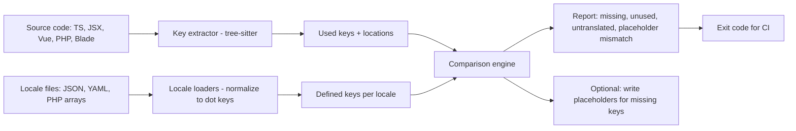
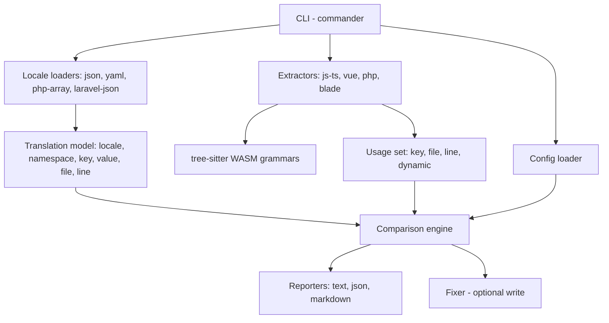
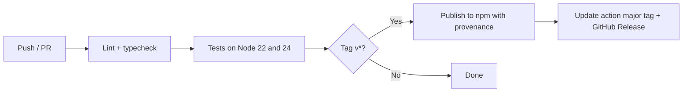

# i18n-drift

**Find missing, unused, and untranslated translation keys across Laravel and JavaScript code in one check, before your users see raw keys.**

i18n-drift is a command-line tool that compares the translation keys your code actually uses with the keys defined in your locale files. It reports keys that are missing in a locale, keys that no code references anymore, values that were never translated, and placeholder mismatches between languages. It is built for real-world mixed codebases, such as a Laravel backend with Blade views and a React or Vue frontend (Inertia apps), where translations live in both PHP language files and JSON.

> **Project status: Design phase.** This repository contains documentation only. No code has been released. Commands and output below describe the **planned** interface.

---

## Table of Contents

- [Overview](#overview)
- [Problem Statement](#problem-statement)
- [Proposed Solution](#proposed-solution)
- [Goals](#goals)
- [Target Audience](#target-audience)
- [Feature Status](#feature-status)
- [Detailed Feature Breakdown](#detailed-feature-breakdown)
- [Architecture](#architecture)
- [Technology Stack](#technology-stack)
- [Project Directory Structure](#project-directory-structure)
- [Installation](#installation)
- [Configuration](#configuration)
- [CLI Reference](#cli-reference)
- [Usage Examples](#usage-examples)
- [CI Integration](#ci-integration)
- [Docker](#docker)
- [Development Workflow](#development-workflow)
- [Testing Strategy](#testing-strategy)
- [Security Considerations](#security-considerations)
- [Performance](#performance)
- [Release Workflow](#release-workflow)
- [Roadmap](#roadmap)
- [Contributing](#contributing)
- [License](#license)
- [Author, Ownership & Attribution](#author-ownership--attribution)

---

## Overview

| Item | Detail |
|---|---|
| Type | Mini project: CLI tool and GitHub Action |
| Locale formats | JSON (flat and nested), YAML, Laravel PHP array files, Laravel JSON translations |
| Code scanned | JS/TS/JSX/TSX (i18next, react-i18next, vue-i18n, next-intl patterns), Vue SFCs, PHP and Blade (`__()`, `trans()`, `trans_choice()`, `@lang`) |
| Complexity | Intermediate |
| Estimated build time | 5–7 days |

## Problem Statement

Translation bugs are easy to ship and embarrassing to find:

- A developer adds `t('checkout.discount_applied')` but forgets to add it to the Hindi or French locale, so users see the raw key.
- Features are removed, but their keys stay in every locale file, so translators keep translating text nobody sees.
- A value is copied from English into another locale "to translate later" and never is.
- Placeholders drift: English says `Hello, :name` while Spanish says `Hola, :nombre`, so the variable is never filled.

Existing tools usually cover **one ecosystem**: i18next-focused extractors for JavaScript, or Laravel-specific packages for PHP. Teams with a Laravel backend and a JavaScript frontend end up with two partial checks, or none.

## Proposed Solution



## Goals

- One tool that understands both Laravel and JavaScript translation conventions.
- Accurate extraction using syntax trees, so keys in comments or unrelated strings are not counted.
- Honest handling of dynamic keys (`t(\`status.${s}\`)`): report them and allow explicit patterns, rather than guessing.
- Fast enough for a pre-commit hook on medium projects (target to be measured).
- Never modify locale files unless explicitly asked (`--write`).

## Target Audience

- Laravel developers, especially with Inertia (React or Vue) frontends.
- React, Next.js, and Vue teams using i18next, react-i18next, next-intl, or vue-i18n.
- Product teams shipping in multiple languages, including Indian-language localization (Hindi, Gujarati, and others).

## Feature Status

Legend: ✅ Implemented · 🚧 In development · 📋 Planned

| Feature | Status |
|---|---|
| Locale loaders: JSON, YAML, Laravel PHP arrays, Laravel JSON | 📋 Planned |
| Key extraction: JS/TS/JSX/TSX | 📋 Planned |
| Key extraction: PHP and Blade | 📋 Planned |
| Key extraction: Vue single-file components | 📋 Planned (v0.2) |
| Missing, unused, and untranslated checks | 📋 Planned |
| Placeholder consistency check | 📋 Planned |
| Dynamic key reporting and allow patterns | 📋 Planned |
| `--write` to add placeholders for missing keys | 📋 Planned |
| Text, JSON, and Markdown reports | 📋 Planned |
| GitHub Action | 📋 Planned (v0.3) |

## Detailed Feature Breakdown

### 1. Locale loading
All formats are normalized to flat dot-separated keys per locale and namespace:

| Format | Example path | Normalized key |
|---|---|---|
| Laravel PHP array | `lang/en/auth.php` → `['failed' => '...']` | `auth.failed` |
| Laravel JSON | `lang/hi.json` → `{"Welcome back": "..."}` | `Welcome back` (string key) |
| i18next JSON | `public/locales/en/common.json` → `{"nav": {"home": "..."}}` | `common:nav.home` |
| YAML | `locales/fr.yml` → `fr: { nav: { home: ... } }` | `nav.home` |

Laravel PHP language files are parsed with a PHP grammar (tree-sitter), not executed, so i18n-drift does not need PHP installed and never runs project code. Files using computed values that cannot be resolved statically are reported as warnings.

### 2. Key extraction from code

| Ecosystem | Recognized calls |
|---|---|
| i18next / react-i18next | `t('key')`, `i18n.t('key')`, `<Trans i18nKey="key">`, `useTranslation('ns')` namespace binding |
| next-intl | `useTranslations('ns')` followed by `t('key')` → `ns.key` |
| vue-i18n | `$t('key')`, `t('key')`, `v-t="'key'"` |
| Laravel PHP | `__('key')`, `trans('key')`, `trans_choice('key', n)`, `Lang::get('key')` |
| Blade | `{{ __('key') }}`, `@lang('key')`, `@choice('key', n)` |

Function names are configurable for custom wrappers (for example `translate()`).

### 3. Checks

| Check | ID | Default severity |
|---|---|---|
| Key used in code but missing in a locale | `missing` | error |
| Key defined but not used anywhere in code | `unused` | warning |
| Value identical to the base locale (likely untranslated) | `untranslated` | warning |
| Value empty in a non-base locale | `empty` | error |
| Key defined in a non-base locale but missing from the base locale | `extra` | warning |
| Placeholder set differs from base locale (`:name`, `{name}`, `{{name}}`) | `placeholder-mismatch` | error |
| Dynamic key that cannot be resolved statically | `dynamic-key` | note |
| Locale value not statically known (for example a function call in a PHP lang file) | `unknown-value` | note |

The base locale (default `en`) is the reference for untranslated and placeholder checks. Words that legitimately stay the same across languages (brand names, "OK") can be listed in an allowlist.

### 4. Dynamic keys
Calls such as `t(\`order.status.${status}\`)` are reported as `dynamic-key` notes with locations. Users can declare patterns (`order.status.*`) to mark matching defined keys as used and suppress unused warnings for them.

### 5. Writing placeholders
`i18n-drift fix --write` adds missing keys to each locale file, using the base locale value prefixed with a marker (default `[TODO] `) so they are easy to find, preserving existing formatting for JSON and YAML. PHP files are updated only when the array structure is simple and statically known; otherwise the tool lists the keys to add manually.

## Architecture



There is no server, database, or authentication; i18n-drift runs entirely locally.

## Technology Stack

| Concern | Choice | Reason |
|---|---|---|
| Language | TypeScript on Node.js 22+ | Matches the JavaScript ecosystem; easy npm distribution |
| Parsing | `web-tree-sitter` with JavaScript, TypeScript, TSX, PHP, and Vue grammars (WASM) | Accurate syntax trees, no native builds |
| Blade | Custom tokenizer for directives and echo blocks, delegating embedded PHP to the PHP grammar | Blade has no official tree-sitter grammar |
| YAML | `yaml` package (preserves formatting for writes) | Round-trip safe |
| CLI | `commander` | Small and familiar |
| Config validation | `zod` | Clear error messages |
| Testing | Vitest | Fast TypeScript tests |

## Project Directory Structure

```text
i18n-drift/
├── src/
│   ├── cli.ts
│   ├── config.ts
│   ├── locales/            # json.ts, yaml.ts, php-array.ts, laravel-json.ts
│   ├── extractors/         # javascript.ts, vue.ts, php.ts, blade.ts
│   ├── placeholders.ts     # placeholder syntax detection and comparison
│   ├── compare.ts          # checks
│   ├── fix.ts              # writing placeholders
│   └── reporters/          # text.ts, json.ts, markdown.ts
├── grammars/               # tree-sitter WASM files
├── action/                 # GitHub Action wrapper
├── test/
│   └── fixtures/           # laravel-inertia-react, nextjs-next-intl, vue-i18n, blade-only
├── docs/
└── package.json
```

## Installation

> Planned; the package has not been published. The npm package name will be confirmed before the first release.

```bash
npx i18n-drift check
# or
npm install --save-dev i18n-drift
```

From source:

```bash
git clone https://github.com/yagnang-vyas/i18n-drift.git
cd i18n-drift
npm ci
npm run build
node dist/cli.js --help
```

## Configuration

`i18n-drift.config.json` (optional; sensible defaults detect Laravel `lang/` and common JavaScript locale folders):

```json
{
  "baseLocale": "en",
  "locales": ["en", "hi", "gu", "fr"],
  "sources": ["resources/js/**/*.{ts,tsx,vue}", "resources/views/**/*.blade.php", "app/**/*.php"],
  "localeFiles": [
    { "format": "laravel-php", "path": "lang/{locale}/*.php" },
    { "format": "laravel-json", "path": "lang/{locale}.json" }
  ],
  "functions": { "js": ["t", "$t", "translate"], "php": ["__", "trans", "trans_choice"] },
  "dynamicKeyPatterns": ["order.status.*"],
  "untranslatedAllowlist": ["OK", "Email", "GitHub"],
  "severity": { "unused": "warning", "untranslated": "warning" }
}
```

i18n-drift reads no environment variables except `NO_COLOR`.

## CLI Reference

| Command | Description |
|---|---|
| `i18n-drift check` | Run all checks and print a report |
| `i18n-drift keys` | List used keys with locations |
| `i18n-drift fix [--write]` | Show (or apply) placeholder additions for missing keys |
| `i18n-drift init` | Detect project layout and write a config file |

Options: `--config <file>`, `--locale <code>` (limit to one locale), `--format text|json|markdown`, `--fail-on error|warning|note|never` (default `error`), `--only missing,placeholder-mismatch`.

Exit codes: `0` nothing at or above `--fail-on`, `1` findings at or above it, `2` usage or configuration error.

## Usage Examples

**Planned output of `i18n-drift check`:**

```text
i18n-drift · base locale en · 4 locales · 812 keys used in 214 files

error    missing               hi   checkout.discount_applied   resources/js/Pages/Checkout.tsx:48
error    missing               gu   checkout.discount_applied   resources/js/Pages/Checkout.tsx:48
error    placeholder-mismatch  fr   auth.welcome                expected :name, found :nom
warning  untranslated          gu   dashboard.title             same value as en
warning  unused                *    legacy.banner.text          defined in lang/*/legacy.php
note     dynamic-key                order.status.${status}     resources/js/Components/Badge.tsx:12

3 errors, 2 warnings, 1 note
```

Numbers and keys above illustrate the format; they are not results from a real project.

**Planned: add placeholders for missing keys**

```bash
npx i18n-drift fix --write --locale hi
# Added 7 keys to lang/hi.json with "[TODO] " prefix
```

## CI Integration

```yaml
# Example workflow in a consuming project (planned action)
name: Translations
on: [pull_request]
permissions:
  contents: read
jobs:
  i18n:
    runs-on: ubuntu-latest
    steps:
      - uses: actions/checkout@v4
      - uses: yagnang-vyas/i18n-drift@v1
        with:
          fail-on: error
          format: markdown     # also written to the job summary
```

## Docker

```bash
docker run --rm -v "$PWD:/repo" -w /repo ghcr.io/yagnang-vyas/i18n-drift check
```

## Development Workflow

1. Branch from `main` (`feat/`, `fix/`, `extractor/<name>`, `locale/<format>`).
2. Add fixture projects for new frameworks under `test/fixtures/`.
3. Run `npm run lint`, `npm run typecheck`, `npm test`.
4. Use Conventional Commits, e.g. `feat(extractors): support next-intl namespaces`.

See [docs/DEVELOPMENT.md](docs/DEVELOPMENT.md).

## Testing Strategy

| Level | Scope |
|---|---|
| Loaders | Each format, nested and flat keys, namespaces, invalid files with line numbers |
| Extractors | Every recognized call pattern; comments, unrelated strings, and similarly named functions ignored |
| Placeholders | Laravel `:name`, ICU `{name}`, i18next `{{name}}`, pluralization forms |
| Checks | Each check ID triggered and not triggered |
| Fixer | JSON and YAML formatting preserved; PHP writes only for simple arrays |
| Fixture projects | Laravel + Inertia React, Next.js + next-intl, Vue + vue-i18n, Blade-only, end to end |
| CLI | Exit codes and output formats |

## Security Considerations

- i18n-drift never executes project code: PHP language files are parsed, not included.
- No network access.
- `--write` modifies only configured locale files and is never the default.
- Report output contains keys, file paths, and translated strings from locale files, which are normally not secret.

See [SECURITY.md](SECURITY.md).

## Performance

- Files are filtered by glob before parsing; `node_modules`, `vendor`, and build folders are skipped.
- Parsing runs in a worker pool; a content-hash cache skips unchanged files on repeated runs.

## Release Workflow



```yaml
# .github/workflows/ci.yml (planned)
name: CI
on: [push, pull_request]
permissions:
  contents: read
jobs:
  test:
    runs-on: ubuntu-latest
    strategy:
      matrix:
        node: [22, 24]
    steps:
      - uses: actions/checkout@v4
      - uses: actions/setup-node@v4
        with: { node-version: "${{ matrix.node }}", cache: npm }
      - run: npm ci
      - run: npm run lint && npm run typecheck
      - run: npm test
```

## Roadmap

| Version | Scope |
|---|---|
| 0.1 | JSON, Laravel PHP and Laravel JSON loaders; JS/TS/TSX, PHP and Blade extractors; all checks; dynamic key patterns; text, JSON and Markdown reports; `fix --write` for JSON locale files |
| 0.2 | YAML loader, Vue single-file components, next-intl namespaces, PHP locale writes where safe |
| 0.3 | Published GitHub Action, content-hash cache, Docker image |
| Later | Translation memory export (XLIFF), machine-translation provider hooks (opt-in), VS Code extension |

See [docs/ROADMAP.md](docs/ROADMAP.md).

## Contributing

Extractors for more frameworks and locale formats are welcome. Please read [CONTRIBUTING.md](CONTRIBUTING.md) and the [Code of Conduct](CODE_OF_CONDUCT.md).

**Suggested GitHub topics:** `i18n`, `l10n`, `translations`, `laravel`, `inertiajs`, `i18next`, `vue-i18n`, `next-intl`, `cli`

**Repository description:** Find missing, unused, and untranslated translation keys across Laravel and JavaScript code in one check, with CI exit codes.

## License

Planned license: **MIT**. See [LICENSE](LICENSE).

## Author, Ownership & Attribution

i18n-drift is designed, written, and maintained by **Yagnang Vyas**.

| | |
|---|---|
| **Name** | Yagnang Vyas |
| **Email (Git commits)** | 168338381+yagnang-vyas@users.noreply.github.com |
| **GitHub** | [https://github.com/yagnang-vyas](https://github.com/yagnang-vyas) |
| **Repository** | [https://github.com/yagnang-vyas/i18n-drift](https://github.com/yagnang-vyas/i18n-drift) |

### Git configuration for this repository

Configure the commit identity locally in this repository before committing:

```bash
git config user.name "Yagnang Vyas"
git config user.email "168338381+yagnang-vyas@users.noreply.github.com"
```

Verify it:

```bash
git config user.name     # expected: Yagnang Vyas
git config user.email    # expected: 168338381+yagnang-vyas@users.noreply.github.com
```

### Attribution rules for i18n-drift

These rules apply to this repository independently, including its README and supporting documentation, Git commit author and committer settings, package metadata and manifests, GitHub repository description and metadata, and all future commits and contributions.

1. `Yagnang Vyas` is the only project author and maintainer.
2. Git commits use only the GitHub noreply email `168338381+yagnang-vyas@users.noreply.github.com`.
3. No former or alternate username of the owner (including the previous GitHub handle), and no email associated with it, may ever be used.
4. No AI tool or AI company is listed as an author, co-author, contributor, maintainer, or credit.
5. No `Co-authored-by` trailers are added to commits.
6. No AI signatures, watermarks, AI attribution badges, or promotional references are added.
7. No AI tools are added to GitHub contributors or project metadata.
8. No artificial contributors or misleading authorship claims are added.
9. Documentation, package metadata (for example `package.json`, `pyproject.toml`, `composer.json`, extension manifests), repository metadata, and author references consistently use the identity above.
10. The existing Conventional Commit history and commit message conventions are preserved.
11. Existing commit history is not rewritten, amended, squashed, or otherwise altered unnecessarily.
12. Completed implementations are not changed unnecessarily.
13. Commit authorship and repository attribution are verified before pushing to GitHub.

### Verifying authorship before pushing

```bash
# Author and committer of commits not yet on the remote
git log origin/main..HEAD --format='%h  author=%an <%ae>  committer=%cn <%ce>'

# Look for trailers that must not be present
git log origin/main..HEAD --format='%B' | grep -i 'co-authored-by' && echo "Remove trailers before pushing"
```

Every line of the first command should show `Yagnang Vyas <168338381+yagnang-vyas@users.noreply.github.com>` for both author and committer.

External contributors keep authorship of their own commits in the normal way; these rules govern the maintainer identity and project metadata.
