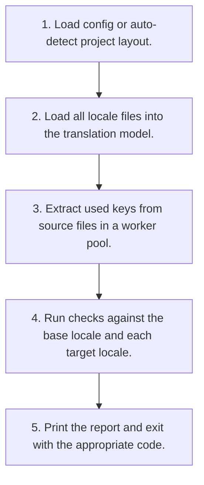

# i18n-drift Architecture

This document describes the planned architecture of i18n-drift, a translation key drift checker for Laravel and JavaScript. It complements the overview in the [README](../README.md).

> **Status:** Design phase. Everything here is a proposal and will be updated as the implementation progresses. Decisions are recorded as lightweight architecture decision records (ADRs) below.

## Components

| Component | Responsibility |
|---|---|
| CLI (`src/cli.ts`) | Commands, options, exit codes. |
| Config (`src/config.ts`) | Auto-detection of Laravel and JavaScript layouts, validated config file. |
| Locale loaders (`src/locales/`) | JSON, YAML, Laravel PHP arrays, Laravel JSON normalized to dot keys with file and line. |
| Extractors (`src/extractors/`) | tree-sitter based extraction for JS/TS/JSX/TSX, Vue, PHP; Blade tokenizer. |
| Comparison engine (`src/compare.ts`) | Missing, unused, untranslated, empty, placeholder mismatch, dynamic keys. |
| Fixer (`src/fix.ts`) | Adds placeholders for missing keys while preserving formatting. |
| Reporters (`src/reporters/`) | Text, JSON, and Markdown output. |

## Key flows

### `i18n-drift check`

1. Load config or auto-detect project layout.
2. Load all locale files into the translation model.
3. Extract used keys from source files in a worker pool.
4. Run checks against the base locale and each target locale.
5. Print the report and exit with the appropriate code.

## Architecture decisions

### ADR-001: Parse PHP instead of executing it

**Status:** Proposed

No PHP runtime required and no risk of running project code; computed values are reported rather than guessed.

### ADR-002: One model for all formats

**Status:** Proposed

Normalizing every format to dot keys lets one comparison engine serve Laravel and JavaScript projects together.

### ADR-003: Dynamic keys are reported, not guessed

**Status:** Proposed

Guessing would create false confidence; explicit patterns keep results honest.

## Cross-cutting concerns

- **Configuration:** all runtime configuration comes from environment variables or configuration files documented in the README; no hard-coded secrets.
- **Errors:** failures are surfaced with actionable messages; unexpected errors are logged with context but without sensitive values.
- **Testing:** each component is testable in isolation; see the Testing Strategy section of the README.
- **Security:** see [SECURITY.md](../SECURITY.md) and the Security Considerations section of the README.

## Open questions

Design questions that remain open are tracked as GitHub issues labeled `design`. Feedback is welcome.

---

Maintained by **Yagnang Vyas** ([https://github.com/yagnang-vyas](https://github.com/yagnang-vyas)).
