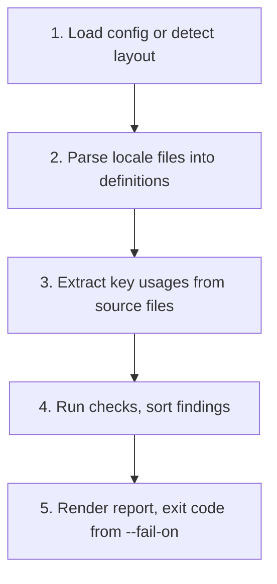

# i18n-drift Architecture

This document describes how i18n-drift v0.1.0 is built. It complements the overview in the [README](../README.md) and the behavior specification in [SPEC.md](../SPEC.md).

## Components

| Component | Responsibility |
|---|---|
| CLI entry (`src/cli.ts`) | Starts `main`, exits with `141` when the output pipe closes and `130` on SIGINT. |
| Application (`src/app.ts`) | Argument parsing with `node:util` `parseArgs`, the `check`, `keys`, `fix` and `init` commands, exit codes, one-line error messages. Takes injected streams so it is testable in process. |
| Config (`src/config.ts`) | Validates `i18n-drift.config.json` with hand-written validators (every error names the JSON path), applies defaults, fills gaps from detection. |
| Detection (`src/detect.ts`) | Recognizes a Laravel project (`artisan` plus `lang/` or `resources/lang/`) and i18next locale folders; produces locale file patterns, source globs and excludes. |
| Analysis (`src/analyze.ts`) | Pipeline: load locales, choose the base locale, scan source files, run the checks. |
| Locale loaders (`src/locales/`) | `json.ts` and `laravel-json.ts` (via the position-aware parser `json-ast.ts`), `laravel-php.ts` (tree-sitter), `pattern.ts` (`{locale}`/`{namespace}` path patterns), `index.ts` (file discovery and dispatch). |
| Extractors (`src/extractors/`) | `javascript.ts` (JS/TS/JSX/TSX), `php.ts`, `blade.ts` (scanner that delegates PHP fragments to `php.ts`), `index.ts` (dispatch by file name). |
| Parser (`src/parser.ts`) | Loads `web-tree-sitter` and the vendored WASM grammars once; `withTree` guarantees native trees are freed. |
| Placeholders (`src/placeholders.ts`) | Extracts Laravel, ICU and i18next placeholders as comparable tokens. |
| Comparison engine (`src/compare.ts`) | The eight checks, key resolution, deterministic sorting. |
| Fixer (`src/fix.ts`) | Plans additions from `missing` findings and edits JSON text in place, atomically. |
| Reports (`src/report/`) | Text, JSON and Markdown renderers and the summary. |

## Data model

```ts
Definition { locale, key, value | null, file, line, format, namespace?, jsonPath?, specIndex }
Usage      { key, file, line, column, dynamic, pattern? }
Finding    { id, severity, locale | null, key | null, file | null, line | null, message }
```

Keys are normalized when a definition or usage is created (see [SPEC.md](../SPEC.md), "Key normalization"), so the comparison engine only deals with strings.

## Key flows

### `i18n-drift check`

1. Load `i18n-drift.config.json` or detect the project layout (`config.ts`, `detect.ts`).
2. List the locale files from the `localeFiles` patterns and parse them into definitions (`locales/`). JSON goes through the position-aware parser; PHP arrays go through tree-sitter.
3. List source files from the `sources` globs, minus excludes and minus the locale files, and extract usages (`extractors/`). Files are processed sequentially.
4. Run the checks against the base locale and each other locale (`compare.ts`).
5. Print the report and exit with the code derived from `--fail-on`.



### `i18n-drift fix --write`

1. Run the analysis; take the `missing` findings of non-base locales.
2. Resolve each key to its base definitions (default namespace and plural families included). Keys without a base value are reported as not fixable.
3. For JSON targets, compute the file from the locale file pattern and the key's JSON path from the base file; for PHP targets only print the key.
4. Compute all edited file contents in memory (`insertJsonKey`: textual insertion, formatting preserved). If any file is invalid JSON, nothing is written.
5. Replace each file atomically (temporary file in the same directory, then rename); refuse symbolic links and paths outside the project.

### Blade extraction

`blade.ts` blanks Blade comments and `@verbatim` blocks (keeping offsets), then scans once for PHP-bearing constructs: echoes, `<?php`/`<?=` blocks, `@php` blocks, directives with parenthesized arguments, and bound `<x-...>` attributes. Each fragment is wrapped into a small PHP document (`<?php __(ARGS);` for `@lang`/`@choice`, `<?php f(ARGS);` for other directives) and parsed by `php.ts`; the wrapper length is subtracted from the reported offsets so line and column refer to the template.

## Architecture decisions

### ADR-001: Parse PHP instead of executing it

**Status:** Accepted

No PHP runtime is required and no project code can run. Only literal values of the returned array are read; computed values become `unknown-value` notes. A hostile language file is part of the test suite.

### ADR-002: One model for all formats

**Status:** Accepted

Normalizing every format to string keys lets one comparison engine serve Laravel and JavaScript projects together. The cost is that a few semantics have to be encoded in key shape (namespace prefix, plural suffixes); they are documented in the SPEC.

### ADR-003: Dynamic keys are reported, not guessed

**Status:** Accepted

A usage that cannot be resolved becomes a `dynamic-key` note. Only when static text surrounds the dynamic part is a wildcard pattern derived, and matching definitions are treated as used. Explicit `dynamicKeyPatterns` cover the rest.

### ADR-004: Edit JSON text, do not re-serialize

**Status:** Accepted

`JSON.parse` + `JSON.stringify` would reorder integer-like keys and reformat the file. The fixer instead parses with a position-aware parser and inserts text at exact offsets, so existing content, indentation, key order, line endings and the trailing newline are untouched.

### ADR-005: Hand-written configuration validation

**Status:** Accepted

The configuration has about a dozen keys. Hand-written validators keep the dependency list to `web-tree-sitter` and `fast-glob` and produce messages that start with the JSON path.

### ADR-006: Vendored WASM grammars

**Status:** Accepted

The grammars come from the `tree-sitter-wasms` package (version pinned in `grammars/NOTICE.md`) and are copied into `grammars/`, which is published with the package. Users need no native build step and no network access.

## Cross-cutting concerns

- **Configuration:** all runtime configuration comes from the optional config file and command-line options; the only environment variable read is `NO_COLOR`.
- **Errors:** user-facing failures are `UserError`s printed as `i18n-drift: error: <message>` with exit code 2 and no stack trace; unexpected failures are reported the same way with a request to file a bug.
- **Determinism:** findings are sorted by severity, locale, file, line, key and id; file lists are sorted; there is no time- or order-dependent state.
- **Testing:** every component is unit-tested in isolation; fixture projects assert exact findings; the built executable is tested as a spawned process. See the Testing Strategy section of the README.
- **Security:** see [SECURITY.md](../SECURITY.md) and the Security Considerations section of the README.

## Open questions

Design questions that remain open are tracked as GitHub issues labeled `design`. Feedback is welcome.

---

Maintained by **Yagnang Vyas** ([https://github.com/yagnang-vyas](https://github.com/yagnang-vyas)).
